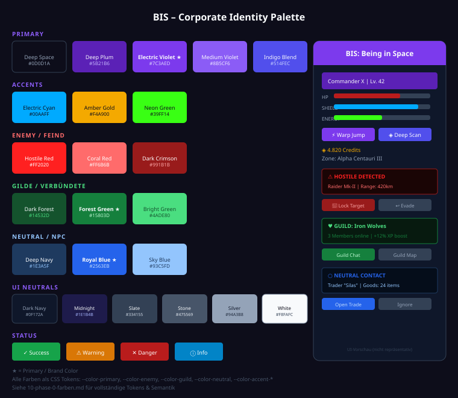

# 🎨 BIS – Corporate Identity Farben

> Basis-Inspiration: Schwarz + Lila (Darkwing Duck) + Sci-Fi-Erweiterung

## Referenzpalette (SVG)

Siehe [`10-phase-0-farben.svg`](10-phase-0-farben.svg) für eine visuelle Übersicht.



---

## Primärfarben

| Rolle | Name | Hex | Vorschau |
|---|---|---|---|
| Background | Deep Space Black | `#0D0D1A` | <span style="display:inline-block;background:#0D0D1A;width:60px;height:16px;border-radius:4px;border:1px solid #334155;"></span> |
| Primary | Electric Violet | `#7C3AED` | <span style="display:inline-block;background:#7C3AED;width:60px;height:16px;border-radius:4px;"></span> |
| Primary Light | Medium Violet | `#8B5CF6` | <span style="display:inline-block;background:#8B5CF6;width:60px;height:16px;border-radius:4px;"></span> |
| Primary Dark | Deep Plum | `#5B21B6` | <span style="display:inline-block;background:#5B21B6;width:60px;height:16px;border-radius:4px;"></span> |
| Primary Blend | Indigo Blend | `#514FEC` | <span style="display:inline-block;background:#514FEC;width:60px;height:16px;border-radius:4px;"></span> |

---

## Akzentfarben

| Rolle | Name | Hex | Vorschau |
|---|---|---|---|
| Accent 1 – Tech | Electric Cyan | `#00AAFF` | <span style="display:inline-block;background:#00AAFF;width:60px;height:16px;border-radius:4px;"></span> |
| Accent 2 – Wert | Amber Gold | `#F4A900` | <span style="display:inline-block;background:#F4A900;width:60px;height:16px;border-radius:4px;"></span> |
| Accent 3 – Energie | Neon Green | `#39FF14` | <span style="display:inline-block;background:#39FF14;width:60px;height:16px;border-radius:4px;"></span> |

---

## Feind-Farben

| Rolle | Name | Hex | Vorschau |
|---|---|---|---|
| Enemy Primary | Hostile Red | `#FF2020` | <span style="display:inline-block;background:#FF2020;width:60px;height:16px;border-radius:4px;"></span> |
| Enemy Secondary | Coral Red | `#FF6B6B` | <span style="display:inline-block;background:#FF6B6B;width:60px;height:16px;border-radius:4px;"></span> |
| Enemy Dark | Dark Crimson | `#991B1B` | <span style="display:inline-block;background:#991B1B;width:60px;height:16px;border-radius:4px;"></span> |

---

## Gilden-Farben

| Rolle | Name | Hex | Vorschau |
|---|---|---|---|
| Guild Primary | Forest Green | `#15803D` | <span style="display:inline-block;background:#15803D;width:60px;height:16px;border-radius:4px;"></span> |
| Guild Secondary | Bright Green | `#4ADE80` | <span style="display:inline-block;background:#4ADE80;width:60px;height:16px;border-radius:4px;"></span> |
| Guild Dark | Dark Forest | `#14532D` | <span style="display:inline-block;background:#14532D;width:60px;height:16px;border-radius:4px;"></span> |

---

## Neutrale NPC-Farben

| Rolle | Name | Hex | Vorschau |
|---|---|---|---|
| Neutral Primary | Royal Blue | `#2563EB` | <span style="display:inline-block;background:#2563EB;width:60px;height:16px;border-radius:4px;"></span> |
| Neutral Secondary | Sky Blue | `#93C5FD` | <span style="display:inline-block;background:#93C5FD;width:60px;height:16px;border-radius:4px;"></span> |
| Neutral Dark | Deep Navy Blue | `#1E3A5F` | <span style="display:inline-block;background:#1E3A5F;width:60px;height:16px;border-radius:4px;"></span> |

---

## Neutrale / UI-Farben

| Rolle | Name | Hex | Vorschau |
|---|---|---|---|
| Surface | Dark Navy | `#0F172A` | <span style="display:inline-block;background:#0F172A;width:60px;height:16px;border-radius:4px;border:1px solid #334155;"></span> |
| Card Background | Midnight | `#1E1B4B` | <span style="display:inline-block;background:#1E1B4B;width:60px;height:16px;border-radius:4px;"></span> |
| Border | Slate | `#334155` | <span style="display:inline-block;background:#334155;width:60px;height:16px;border-radius:4px;"></span> |
| Text Primary | White | `#F8FAFC` | <span style="display:inline-block;background:#F8FAFC;width:60px;height:16px;border-radius:4px;border:1px solid #94A3B8;"></span> |
| Text Secondary | Silver | `#94A3B8` | <span style="display:inline-block;background:#94A3B8;width:60px;height:16px;border-radius:4px;"></span> |
| Text Muted | Stone | `#475569` | <span style="display:inline-block;background:#475569;width:60px;height:16px;border-radius:4px;"></span> |

---

## Status-Farben

| Rolle | Name | Hex | Vorschau |
|---|---|---|---|
| Success | Deep Green | `#16A34A` | <span style="display:inline-block;background:#16A34A;width:60px;height:16px;border-radius:4px;"></span> |
| Warning | Amber | `#D97706` | <span style="display:inline-block;background:#D97706;width:60px;height:16px;border-radius:4px;"></span> |
| Danger | Deep Red | `#B91C1C` | <span style="display:inline-block;background:#B91C1C;width:60px;height:16px;border-radius:4px;"></span> |
| Info | Ice Blue | `#0284C7` | <span style="display:inline-block;background:#0284C7;width:60px;height:16px;border-radius:4px;"></span> |

---

## Farbsemantik (Verwendung im Spiel)

| Farbe | Vorschau | Semantik |
|---|---|---|
| `#7C3AED` Electric Violet | <span style="display:inline-block;background:#7C3AED;width:60px;height:16px;border-radius:4px;"></span> | Marke, Logo, Primär-UI, Aktionen |
| `#00AAFF` Electric Cyan | <span style="display:inline-block;background:#00AAFF;width:60px;height:16px;border-radius:4px;"></span> | Schilde, Tech-UI, Links |
| `#F4A900` Amber Gold | <span style="display:inline-block;background:#F4A900;width:60px;height:16px;border-radius:4px;"></span> | Ressourcen, Credits, Rang-Badges, Premium |
| `#39FF14` Neon Green | <span style="display:inline-block;background:#39FF14;width:60px;height:16px;border-radius:4px;"></span> | Energie, Triebwerke, Reaktoren, Buffs |
| `#FF2020` Hostile Red | <span style="display:inline-block;background:#FF2020;width:60px;height:16px;border-radius:4px;"></span> | Feinde, Ziel-Markierung, Aggro-UI |
| `#FF6B6B` Coral Red | <span style="display:inline-block;background:#FF6B6B;width:60px;height:16px;border-radius:4px;"></span> | Feind-Schiff-Highlight, Treffer-Effekt |
| `#991B1B` Dark Crimson | <span style="display:inline-block;background:#991B1B;width:60px;height:16px;border-radius:4px;"></span> | Gefahrenzone, Feind-Hintergrund |
| `#B91C1C` Deep Red | <span style="display:inline-block;background:#B91C1C;width:60px;height:16px;border-radius:4px;"></span> | HP-Balken, Schaden, Alarm, kritische Warnungen |
| `#991B1B` Dark Crimson | <span style="display:inline-block;background:#991B1B;width:60px;height:16px;border-radius:4px;"></span> | Kritischer HP-Zustand, Gefahrenzone, Feind-Hintergrund |
| `#514FEC` Indigo Blend | <span style="display:inline-block;background:#514FEC;width:60px;height:16px;border-radius:4px;"></span> | Sekundäre Aktions-Buttons (Scan, Inspect), Mischton Lila–Blau |
| `#8B5CF6` Medium Violet | <span style="display:inline-block;background:#8B5CF6;width:60px;height:16px;border-radius:4px;"></span> | Primary Light, hover-Zustände, Highlights |
| `#16A34A` Deep Green | <span style="display:inline-block;background:#16A34A;width:60px;height:16px;border-radius:4px;"></span> | Heilung, Erfolg, Online-Status |
| `#15803D` Forest Green | <span style="display:inline-block;background:#15803D;width:60px;height:16px;border-radius:4px;"></span> | Gilden-UI, Mitglieder-Marker, verbündete Schiffe |
| `#4ADE80` Bright Green | <span style="display:inline-block;background:#4ADE80;width:60px;height:16px;border-radius:4px;"></span> | Gilden-Highlight, Verbündeten-Ping, positive Events |
| `#2563EB` Royal Blue | <span style="display:inline-block;background:#2563EB;width:60px;height:16px;border-radius:4px;"></span> | Neutrale NPCs, unbekannte Kontakte, Handels-UI |
| `#93C5FD` Sky Blue | <span style="display:inline-block;background:#93C5FD;width:60px;height:16px;border-radius:4px;"></span> | Neutrale Schiff-Highlight, passive Zone |

---

## CSS Custom Properties (Design Tokens)

```css
:root {
  /* Backgrounds */
  --color-bg-base:     #0D0D1A;
  --color-bg-surface:  #0F172A;
  --color-bg-card:     #1E1B4B;

  /* Primary */
  --color-primary:     #7C3AED;
  --color-primary-lt:  #8B5CF6;
  --color-primary-dk:  #5B21B6;
  --color-primary-blend: #514FEC;

  /* Accents */
  --color-accent-cyan:  #00AAFF;
  --color-accent-gold:  #F4A900;
  --color-accent-neon:  #39FF14;

  /* Enemy */
  --color-enemy:        #FF2020;
  --color-enemy-lt:     #FF6B6B;
  --color-enemy-dk:     #991B1B;

  /* Guild */
  --color-guild:        #15803D;
  --color-guild-lt:     #4ADE80;
  --color-guild-dk:     #14532D;

  /* Neutral NPC */
  --color-neutral:      #2563EB;
  --color-neutral-lt:   #93C5FD;
  --color-neutral-dk:   #1E3A5F;

  /* Text */
  --color-text-primary:   #F8FAFC;
  --color-text-secondary: #94A3B8;
  --color-text-muted:     #475569;

  /* Borders */
  --color-border: #334155;

  /* Status */
  --color-success: #16A34A;
  --color-warning: #D97706;
  --color-danger:  #B91C1C;
  --color-info:    #0284C7;
}
```
