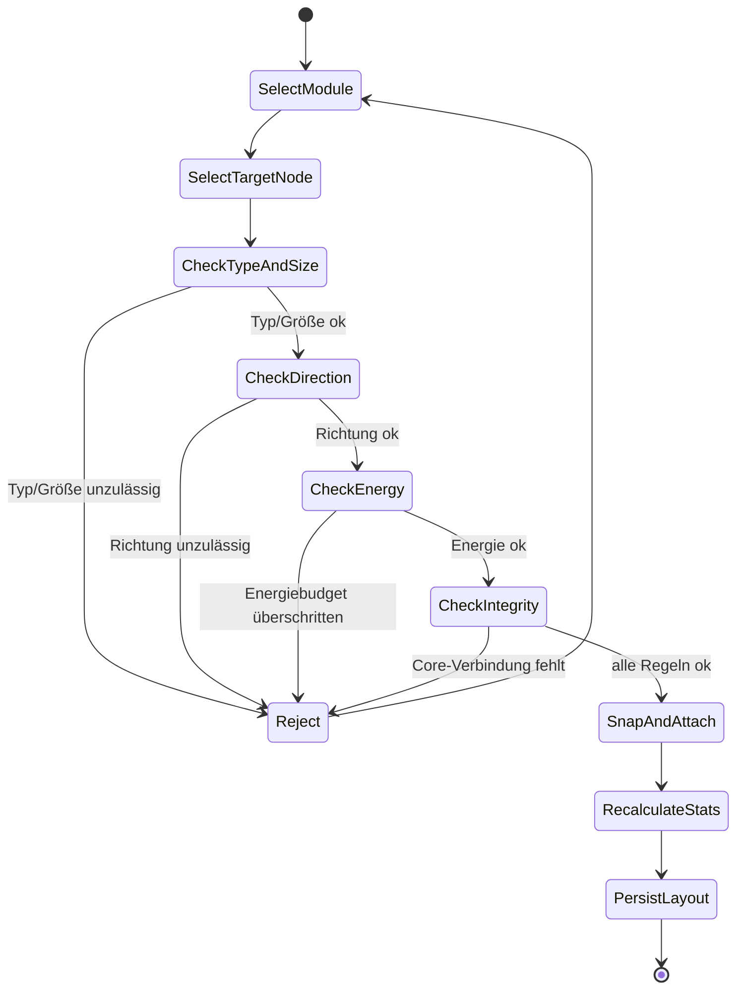
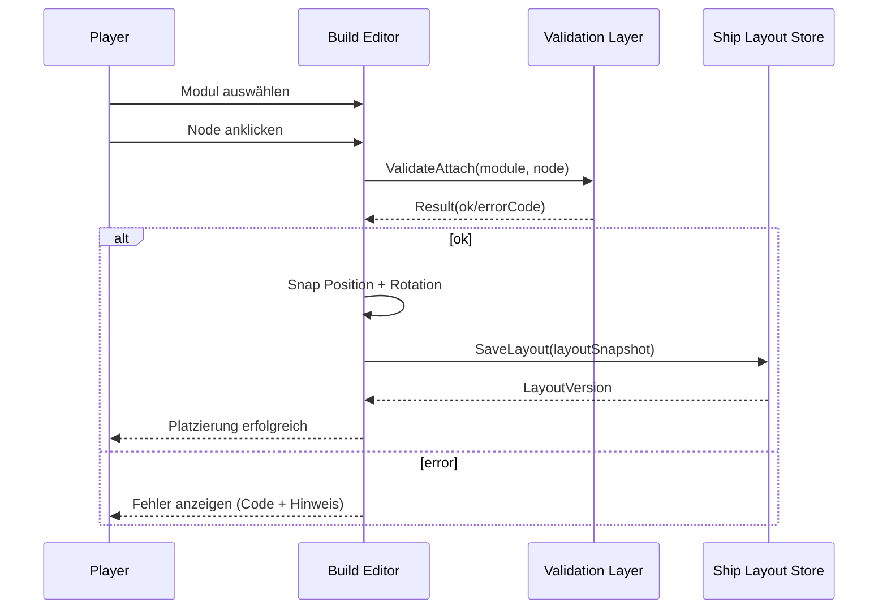

# Spaceship

## TL;DR

Spieler bauen ihre Schiffe modular aus Bausteinen mit festen Docking-Punkten.
Für Phase 2 starten wir mit einem grid-basierten System, klaren Typ- und Größenregeln und deterministischer Validierung.

## 🟢 Zielbild Phase 2

- 🟢 Modulare Schiffe nach Lego-Prinzip ermöglichen
- 🟢 Schnell prüfbare Regeln für Attach/Detach definieren
- 🟢 Datenmodell für spätere Backend- und Unity-Integration vorbereiten
- 🟢 Visuell konsistente Schiffe durch Designregeln sicherstellen

## 🟢 Tooling für schnelle Preview

- 🟢 Mermaid in Markdown für Regel- und Ablaufdiagramme
- 🟢 Markdown-Tabellen für Datenmodell und Kompatibilitätsmatrix
- 🟡 Optional Draw.io für reine Form-/Silhouettenentwürfe

## 🟢 Kernsystem (konzeptuell, Unity-tauglich)

### Modul-Baustein

Jedes Modul enthält:

- Mesh + Collider
- Liste von DockingNodes
- Gameplay-Werte wie HP, Masse, Energiebedarf, Energieproduktion, Kosten

### DockingNode

Jeder DockingNode hat:

- Lokale Position und Rotation
- Typ: Structural, Weapon, Engine, Utility, Energy
- Größe: S, M, L
- Richtung: Front, Back, Left, Right, Top, Bottom

### Snap-Prinzip

- Primär grid-basiertes Snapping (erste Iteration)
- Position und Rotation werden beim Andocken automatisch ausgerichtet
- Freie Constraints erst als spätere Erweiterung

## 🟢 Modulklassen

| Klasse | Zweck | Typische Beispiele |
| --- | --- | --- |
| Structural | Schiff wächst, trägt andere Module | 1x1-Block, 2x1-Block, Zylinder |
| Connector | Verzweigungen und Richtungswechsel | T-Stück, Kreuzstück, Gelenk |
| Engine | Schub erzeugen | Thruster S/M/L |
| Weapon | Offensive Systeme | Laser, Railgun, Rakete |
| Energy | Versorgung des Schiffs | Reaktor, Batterie |
| Utility | Spezialfunktionen | Scanner, Drone Bay, Schildprojektor |

## 🟢 Minimales Datenmodell

| Objekt | Felder | Beschreibung |
| --- | --- | --- |
| ShipLayout | ShipId, Seed, Modules[] | Vollständiger Bauzustand des Schiffs |
| ShipModule | ModuleId, DefinitionId, GridPosition, Rotation, Stats | Instanz eines platzierten Moduls |
| DockingNode | NodeId, ParentModuleId, NodeType, Size, Direction, IsOccupied | Andockpunkt eines Moduls |
| ValidationError | Code, SourceModuleId, TargetNodeId, Message | Ergebnis bei ungültiger Platzierung |

## 🟢 Kompatibilitätsregeln

| Regel | Beschreibung |
| --- | --- |
| Größe | Modulgröße darf Node-Größe nicht überschreiten |
| Typ | Modultyp muss zu NodeType passen |
| Richtung | Engine nur an rückwärts gerichtete Knoten |
| Blockierung | Weapon braucht freie Sichtlinie |
| Energie | Gesamtverbrauch darf Produktion nicht überschreiten |
| Integrität | Jedes Modul muss direkt oder indirekt mit Core verbunden bleiben |

## 🟢 2×2×2 Würfel-Standard (Phase 2)

### Basis-Baustein

- **Größe**: 2m × 2m × 2m (ein Mensch passt rein, ideal für Crew/Habitat)
- **Phase 2 Definition**: Alle Module sind M-Größe (2×2×2); S und L sind zukünftige Varianten
- **Mesh**: Quader mit hartkantigem Hard-Sci-Fi-Look
- **Collider**: Standard-Würfel-Collider für Physics
- **Gewicht**: Basis-Modul ~1 Tonne

### Andockpunkte pro Fläche (9 Punkte)

Jede der 6 Würfelflächen hat **9 Andockpunkte**:

```
Flächen-Layout (2×2 Gitter):
┌─────┬─────┬─────┐
│ 1   │  2  │  3  │  1,3,7,9 = Ecken (auf Kanten-Mitten)
├─────┼─────┼─────┤  2,4,6,8 = Raster-Punkte (0,5/1,5)
│ 4   │  5  │  6  │  5       = Mitte
├─────┼─────┼─────┤
│ 7   │  8  │  9  │
└─────┴─────┴─────┘
```

**Andock-Logik:**

- **Typ**: NodeType ist immer Structural für M-Module
- **Größe**: Jeder Punkt kann ein M-Modul aufnehmen
- **Richtung**: Orthogonal (6 Flächen) + Kanten-Ecken (diagonal erlaubt)
- **Limit**: Pro Fläche max. 1 Module auf Mittelpunkt, OR bis zu 4 auf Raster/Kanten (abhängig von Modul-Typ)

### Funktions-Module (M-Standard)

| Modul | Typ | Andock-Constraint | Gameplay-Wert |
| --- | --- | --- | --- |
| Core Structural | Structural | Zentrum, alle Richtungen erlaubt | HP=100, Masse=1 |
| Engine Thruster | Engine | Nur Back-Fläche, 1x pro Seite | Thrust=+40, Energie=-20/s |
| Reactor | Energy | Beliebig, max. 2 pro Schiff | Power=+60/s, Masse=2 |
| Weapon Laser | Weapon | Front/Top/Bottom, max. 2 | Schaden=25, Energie=-15/s |
| Cargo Bay | Utility | Beliebig, max. 4 | Kapazität=+20 Items, Masse=0,5 |
| Habitat Pod | Utility | Beliebig, max. 2 | Crew Capacity=1 Person, Energie=-5/s |

### Verbindungs-Regeln (Phase 2)

- **Orthogonal-Andocking**: Modul-Fläche zu Würfel-Fläche (klassisches Grid-Snapping)
- **Kanten-Andocking**: Modul-Ecke zur Würfel-Kante (diagonal, erweiterte Flexibilität)
- **Keine Rotation**: Alle M-Module alignen sich zu den Würfel-Achsen (0°, 90°, 180°, 270°)
- **Collision**: Keine Überlappung; Modulgrenzen sind hart

### Balancing Phase 2

- **Energie**: Core = 0 Produktion; jeder Reactor = +60 Produktion; jedes Modul verbraucht
- **Masse**: Schub-Verhältnis: je +20 Masse → +1 Engine nötig
- **Platzlimit**: Schiffe können beliebig groß wachsen, aber Spieler-Skillcheck durch Energiebudget

## 🟢 Mermaid: Validierungszustände



## 🟢 Mermaid: Konzept-Ablauf (Bauen)



## 🟢 Designregeln für stimmige Optik

- Einheitliche Docking-Ringe und Materialien an Übergängen
- Shape-Familie Hard-Sci-Fi als Standard (Quader/Zylinder)
- Keine Kugeln als Haupt-Basisbausteine
- Automatische Übergangsteile als spätere Qualitätsstufe

## 🟢 Balancing-Basis

- Mehr Module erhöhen Masse
- Schub muss mit Masse skalieren
- Energieproduktion limitiert Wachstum
- Optional später: Schwerpunkt/Trägheit für Fluggefühl

## 🔘 Unity-Machbarkeit: Checkliste (ohne Code)

- 🔘 Ist jede Platzierungsentscheidung rein datengetrieben reproduzierbar?
- 🔘 Sind alle Validierungsregeln deterministisch und serverseitig prüfbar?
- 🔘 Gibt es für jeden Fehlerfall einen klaren Fehlercode?
- 🔘 Lässt sich das Layout als Snapshot serialisieren?
- 🔘 Können neue Modultypen ohne Regelbruch ergänzt werden?

## 🟢 Erste Umsetzungsreihenfolge

1. 🟢 Grid + DockingNode-Regeln festziehen
2. 🟢 Structural + Engine + Energy als Startmodule
3. 🟢 Weapon-Module mit Sichtlinienregel ergänzen
4. 🟡 Utility/Spezialmodule in nächster Iteration
